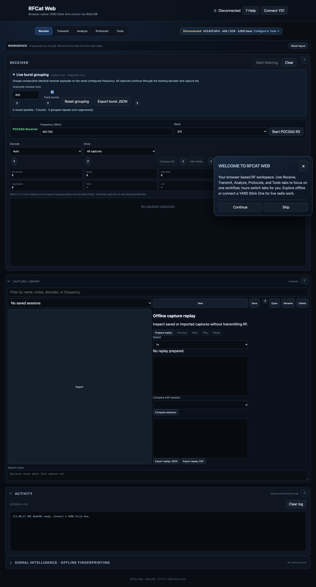
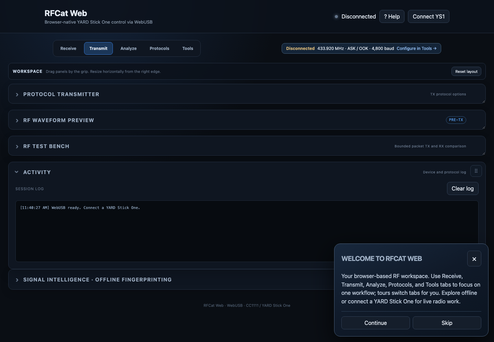
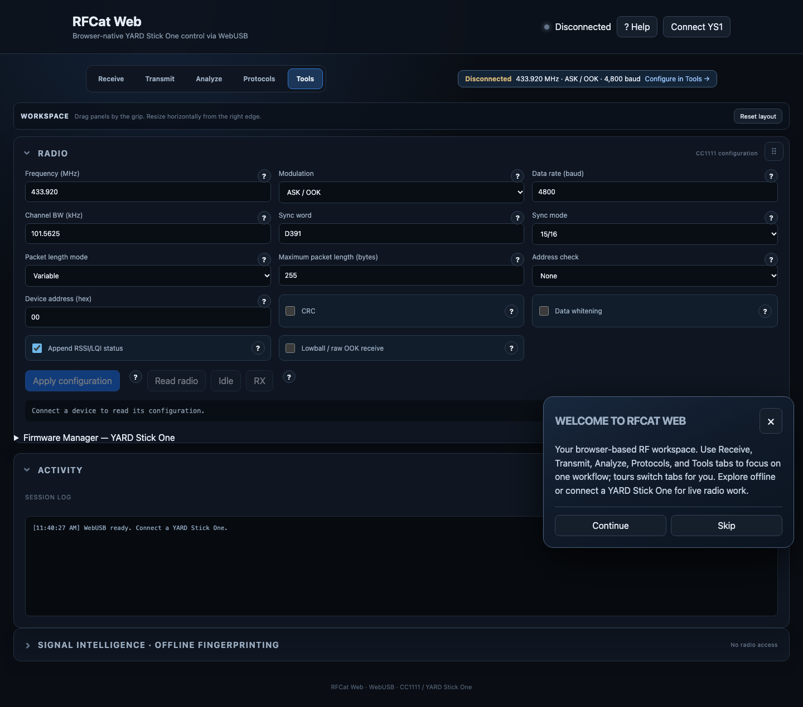
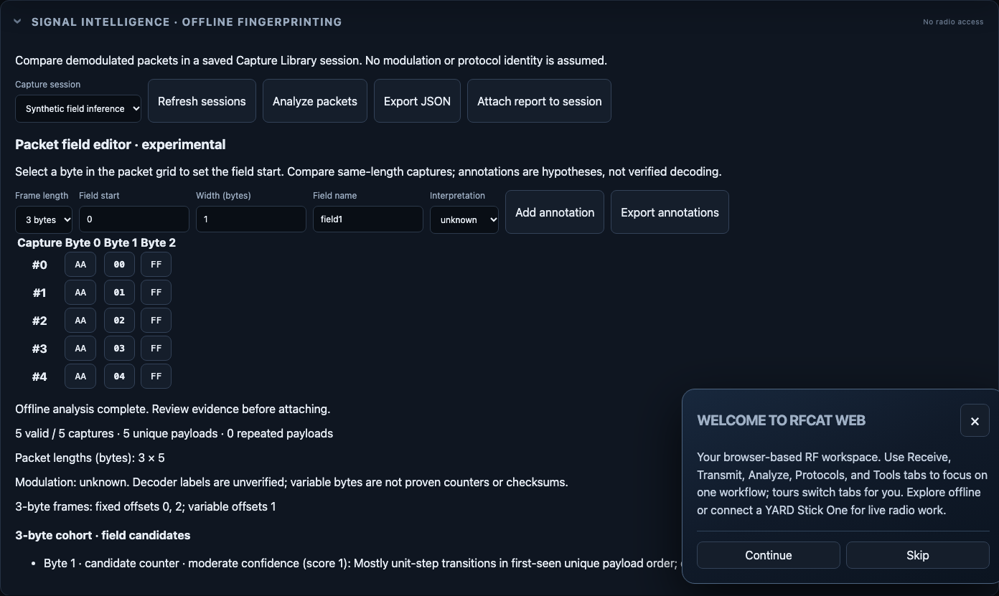

# RFCat Web

**A browser-based RF development, capture, and protocol-analysis workspace for RFCat-compatible CC1111 hardware, including the YARD Stick One.**

RFCat Web uses WebUSB to configure radios, transmit test frames, capture and decode traffic, inspect waveforms, and build or validate protocol definitions. The project is a general-purpose RF engineering tool—not a single-protocol or Flipper-specific application.

## What you can do

- **Configure and transmit:** Set frequency, modulation, data rate, bandwidth, power, and packet settings; transmit using protocol-specific encoders or direct RF test modes. The RF Test Bench previews bounded hexadecimal packet sequences and compares subsequent RX packets byte-for-byte.
- **Receive and decode:** Inspect raw captures, select decoders, and review decoded fields. Auto mode attempts applicable decoders without discarding unknown traffic. Live burst diagnostics group repeated packet events with timestamps, RSSI ranges, adjustable duplicate windows, and JSON export.
- **Build reusable protocol definitions:** Create versioned packet schemas, interpret numeric/bit/enum/checksum fields, validate saved captures, promote field annotations with explicit confirmation, import/export a local IndexedDB library, and passively match live RX packets. See [Protocol Definition Builder](docs/protocol-definition-builder.md).
- **Annotate packet fields:** Compare same-length captures in an interactive hex grid, label tentative byte ranges, and persist or export offline annotations. See [Packet Field Editor](docs/packet-field-editor.md).
- **Fingerprint captured packets:** Use Signal Intelligence to group repeated frames, compare fixed and changing byte positions, review tentative counter/command byte candidates with explicit evidence and caveats, preserve conservative evidence reports in Capture Library, and export JSON. See [Signal Intelligence](docs/signal-intelligence.md).
- **Analyze captures offline:** Import/export JSON, save capture sessions in IndexedDB, step through captures with timed offline playback and timeline navigation, compare saved sessions by payload frequency, export replay reports as JSON/CSV, compare captures, infer changing fields, and validate declarative protocol presets against positive and negative examples.
- **Investigate unknown RF timing:** Import Flipper Zero RAW `.sub` captures in the RF Signal Analyzer panel, inspect waveforms, and review conservative encoding hypotheses. See [RF Signal Analyzer](docs/signal-analyzer.md) for current scope and limitations.
- **Inspect signal timing:** Preview symbol timing and waveform quantization; analyze received OOK pulse distributions.
- **Get guided help:** An optional first-run wizard, searchable Help panel, contextual (?) explanations, and restartable, context-aware task-based and protocol-specific tours, including Intelligent Receiver & Burst Grouping and Offline Capture Replay. See [Guided onboarding and help](docs/help/README.md).
- **Customize your workspace:** Drag, resize, and collapse panels. Layout preferences persist locally in IndexedDB.
- **Interoperate with other devices:** Use specialized workflows such as Momentum Enhanced Sub-GHz Chat with a Flipper Zero.

## Sub-GHz Spectrum Explorer

The [Spectrum Explorer](docs/spectrum-explorer.md) provides stepped-frequency RSSI surveys with baseline comparison, average/peak traces, auto/fixed dBm scaling, frequency-chart hover inspection, target markers, a sweep-by-sweep waterfall, detection indicators, and CSV export. A guided **Spectrum Explorer walkthrough** is available in Help. YARD Stick One testing has demonstrated baseline-relative RF activity near a Flipper Zero transmission at 433.920 MHz; the scanner is not a wideband SDR or calibrated power meter.

## RF signal discovery (in development)

After a Spectrum Explorer scan, select **Investigate strongest signal** (or hover over a frequency first). The investigation transfers the frequency into the existing receiver preset scanner or Receiver without automatically tuning hardware, starts a new evidence boundary, and saves the spectrum snapshot plus subsequent receiver captures to a new Capture Library session. A JSON spectrum report is also available. See [RF signal discovery](docs/rf-signal-discovery.md) and **? Help → RF signal discovery: spectrum to capture**. This feature is on a testing branch and has not yet been merged.

## Screenshots

The screenshots below illustrate the browser workspace without requiring RF hardware. The screenshot generator uses a fixed desktop viewport; disconnected device state is intentional.









Regenerate these images (plus a Firmware Manager screenshot and the synthetic Signal Intelligence example) with `npm run screenshots:readme` after `npm install` and `npx playwright install chromium`. The Playwright browser suite checks the screenshot views and in-memory capture without modifying PNGs; run `npm run verify` to include that regression. Review generated images before committing them; they reflect the UI at capture time, not a connected device or verified RF activity. See [Screenshot automation](docs/readme-screenshots.md).

## Quick start

**Requirements:** RFCat-compatible CC1111 hardware (YARD Stick One is the primary tested device), a WebUSB-capable browser, and a local HTTP server or secure origin. USB permission is granted through the browser.

```bash
git clone https://github.com/jimilinuxguy/rfcat-web.git
cd rfcat-web
python3 -m http.server 8080
```

Open `http://localhost:8080`, connect the YARD Stick One, configure the radio, and choose a transmit or receive workflow. Use only frequencies and devices you are authorized to operate.

Run the automated JavaScript and browser regression tests with:

```bash
npm install
npm test
npx playwright install chromium
npm run test:browser
# Or run both locally with one command:
npm run verify
```

The Playwright suite includes the original 15 hardware-free regression tests covering workspace navigation, persistence, Help, mock WebUSB handshake/readback, permission cancellation, disconnects, retries, write failures, and timeouts. See [UI polish and reliability](docs/polish-reliability.md). Replay adds four hardware-free Playwright acceptance tests for replay navigation, playback, saved-session comparison, and Help. Mocked USB tests do not validate RF hardware or over-the-air behavior.

GitHub Actions also runs the Node test workflow. **Check the actual workflow result:** the presence of tests or a merged PR does not imply CI is passing.

## Protocols and interoperability

The protocol registry includes:

| Area | Implementations |
| --- | --- |
| Paging and alerting | POCSAG, LRS, JTECH, Retekess T112/T119/TD157/TD161/TD164/TD165/TD174 |
| OOK and remote signaling | CAME-12, generic OOK/PWM, Tesla charge-port test signaling, TouchTunes / The Fonz |
| Sensors and telemetry | Acurite 5n1, Oregon THGR122NX, Schrader TPMS variants |
| RF utilities | Binary payloads, Continuous Carrier |

Not all implementations have the same hardware-validation status. Protocol details, framing, known-good captures, and test boundaries live in [protocol documentation](docs/README.md#protocol-reference).

**Momentum Enhanced Sub-GHz Chat** is a separate interoperability panel (not a registry protocol). It supports plaintext and AES-256-GCM encrypted chat with compatible Flipper Zero firmware. See the [Momentum Chat guide](docs/momentum-subghz-chat.md) for setup, payload limits, and validation notes.

See [Offline capture replay](docs/capture-replay.md) for playback controls, timeline, saved-session comparison, limitations and the Help/welcome-wizard walkthrough.

## Capture and protocol-development workflow

```text
Configure radio → Capture / Import → Decode → Save session
                                         ↓
                              Compare / Infer fields
                                         ↓
                             Build protocol preset
                                         ↓
                           Validate / Export JSON
```

Capture sessions and workspace layout are stored locally in the browser's IndexedDB. A protocol preset is an **analysis artifact**, not an automatically installed decoder or an automatic transmission. Exported captures and presets can be shared as JSON.

The [Intelligent Receiver & Capture Pipeline](docs/capture-pipeline.md) adds live burst grouping without suppressing the existing capture list. It tracks packet events rather than guaranteed complete RF frames. The receiver remains packet-engine based. Physical asynchronous OOK remotes may require pulse-oriented sampling, and raw receive boundaries are not always protocol-frame boundaries. See [Receiver and Protocol Decoders](docs/receiver-decoders.md).

The experimental [Morse Code / CW Workbench](docs/cw-workbench.md) adds text-to-Morse, adjustable WPM, offline timing/waveform and sidetone preview, CC1111 OOK packet transmission, raw-sample Morse decoding and Flipper RAW `.sub` pulse import. It is not an HF audio CW receiver; hardware TX/RX validation remains necessary.

See [RF Test Bench](docs/rf-test-bench.md) for repeat limits, authorization safeguards, and validation steps. RF Test Bench is available on `main`; hardware validation remains distinct from unit tests.

## Architecture

- `app.js` and `index.html`: UI and event wiring.
- `js/rfcat/` and `js/radio/`: WebUSB transport, RFCat device operations, and CC1111 radio registers.
- `js/protocols/`: protocol metadata, encoding, RF configuration, TX, and optional RX decoding.
- `js/rx/`, `js/encoding/`, and `js/storage/`: receive analysis, waveform/timing support, and local persistence.
- `js/chat/`: dedicated Momentum chat plaintext and encrypted packet handling.
- `tests/`: Node.js automated tests; `browser-tests/`: Playwright browser regression and mocked WebUSB tests; `tools/`: synthetic capture and waveform utilities.

Browser modules use explicit relative `.js` imports, and the protocol registry is explicit, so the app does not require a bundler.

## Validation and limitations

Different evidence levels mean different things: **unit/synthetic tests**, **over-the-air waveform checks**, and **real-device interoperability**. They are not interchangeable. Reported hardware results include POCSAG and LRS TX/RX, multiple Retekess variants, and Momentum chat exchanges; individual documentation pages describe exactly what was tested and what remains unverified. Do not assume every protocol or radio setup has been tested with every physical target.

For development details, hardware behavior, known-good setups, and limitations, start with the [documentation index](docs/README.md).

## Safety

Transmit only on equipment and frequencies you own or are authorized to use, and comply with local radio regulations. RF test modes should be used for short, controlled bench tests to avoid interference.

### RF Signal Analyzer

Import Flipper Sub-GHz RAW captures, inspect timing clusters and encoding hypotheses, compare candidate bits, and measure pulse timings with waveform cursors. Save analyses in IndexedDB. A connected YARD Stick One can sequentially scan ASK/OOK, 2-FSK and GFSK receiver presets and report packet evidence. Preset scanning is receive-only, interrupts other radio workflows, and does not prove modulation identity. See [signal analyzer guide](docs/signal-analyzer.md). Browser import, waveform cursor dragging, and local save/load/delete have been user-verified; basic YARD Stick One preset scanning has also been reported working. Packet-byte detection, cancellation, and exact configuration restoration are not independently confirmed. Hosted CI availability may be limited; run `npm test` locally.

## Guided Help and RF diagnostics

Use **? Help** to open the searchable, illustrated Help Center. Topics are grouped by radio configuration, signal analysis, capture/decoding, transmission/tools and secure chat; each has a compact SVG illustration and short explanation. Guided tutorials include interactive practice for capture comparison, field inference, preset validation, waveform timing and encrypted Momentum Chat. The welcome wizard is shown on first use and can be restarted from Help.

Choose **Troubleshoot receiver** for prioritized, read-only checks of connection, frequency, receive state, packet counts, decoding, rejections, duplicates and filters. Each finding links to the relevant control via **Inspect**, with a manual **Refresh checks** option. Findings are UI-state hypotheses, not direct RF measurements; Help never starts reception, transmits or applies radio settings. In the Radio panel, contextual help icons align beside field labels, and checkboxes sit beside their corresponding labels in clearly separated rows.

For complete walkthroughs, limitations and manual acceptance checks, see [Guided Help](docs/help/README.md). Run `npm test` locally; browser/hardware validation remains separate from unit tests.

**Advanced Signal Analysis:** The RF Signal Analyzer adds interactive high/low timing histograms with waveform highlighting, selectable decode hypotheses with polarity inversion, repeated-frame pulse comparison and JSON report export. See [Signal Analyzer](docs/signal-analyzer.md). These are offline heuristics, not verified modulation or protocol decoding.


**Protocol Reverse-Engineering Workbench:** Inspect candidate bits, name non-overlapping fields, view bit-order-aware hex/decimal values, identify variable regions across equal-length repeated frames, check simple sum8/xor8 hypotheses, and export a versioned protocol JSON definition. All findings are unverified and offline; definitions are not executable decoders. See [Protocol Workbench](docs/protocol-workbench.md).


### Workspace navigation

The interface now groups existing tools into **Receive**, **Transmit**, **Analyze**, **Protocols**, and **Tools** tabs. Receive shows packet capture and the capture library; Transmit shows the raw transmitter, sequence bench, and waveform preview; Analyze shows the signal analyzer and OOK pulse tools; Protocols contains Morse/CW and Momentum Chat; Tools contains the shared CC1111 radio configuration. The Activity log remains available across workspaces. The active tab is remembered locally under `rfcat.workspace.active.v1`. The interface includes a read-only status summary of the radio form (frequency, modulation, baud rate, and connection state) on every tab; click it to open Tools. These are form values, not independently verified radio register readings.

Workspace navigation preserves existing DOM controls and radio sessions when switching tabs; it does not yet extract protocol controllers into independent modules or add workspace-specific drag layouts. To configure the receiver, open **Tools** and return to **Receive**. No radio command is sent merely by changing tabs.

### Firmware Manager

Tools includes a browser-only YARD Stick One firmware manager using Web Serial for the CC1111 CDC ACM bootloader. It validates Intel HEX boundaries, requires explicit erase confirmation, and checks flash readback before reporting verification. **A full backup → erase → program → programmed-record verify → run → WebUSB reconnect cycle has been validated on a real YARD Stick One.** Full-region post-flash verification is newly added and still requires hardware validation. See [Firmware Manager](docs/firmware-manager.md) for prerequisites, recovery and limitations.
